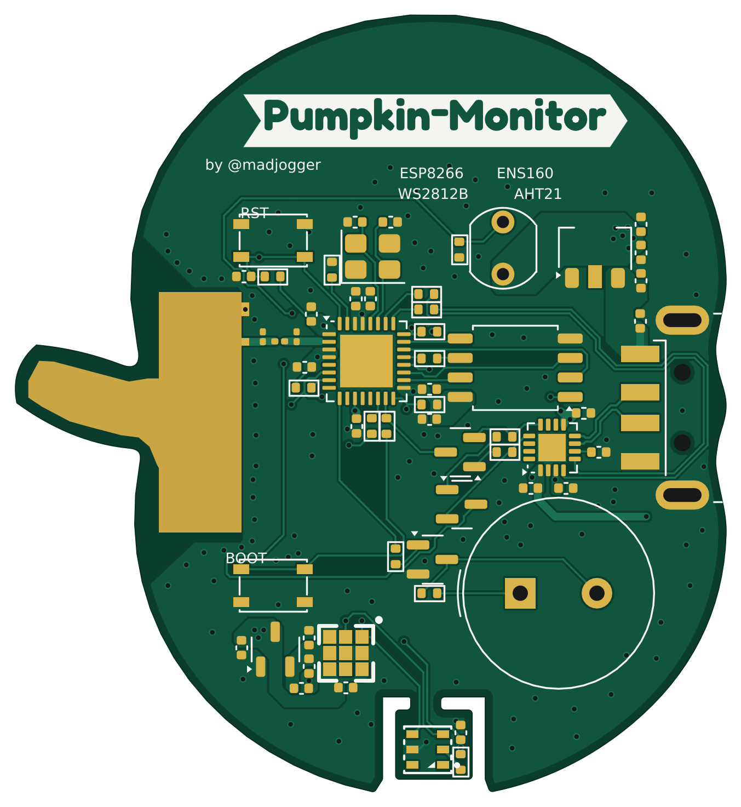
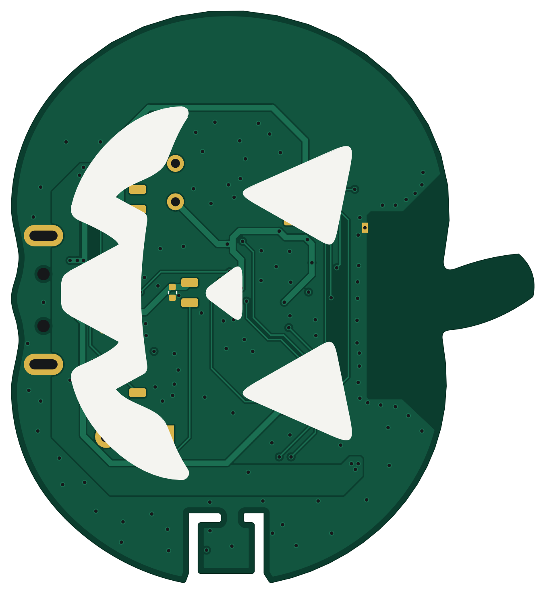

# Pumpkin-Monitor

> Pumpkin-shaped USB air-quality monitor on a bare **ESP8266EX** with a PCB antenna.  
> **ENS160** + **AHT21** sensors, a light sensor, a buzzer and six RGB LEDs glowing through the jack-o'-lantern face on the back.

<p align="center">
  
  
</p>
<p align="center"><i>Board preview (top / bottom) generated from the KiCad board file</i></p>

---

## Overview

Pumpkin-Monitor plugs straight into a USB-A port and works as a small Wi-Fi air-quality station.  
The ESP8266 is used as a **bare chip** (not a module): crystal, SPI flash, RF matching and an inverted-F PCB antenna are all on the board — the antenna lives in the pumpkin "stem".

---

## What's on the board

| Block | Part | Purpose |
|:--|:--|:--|
| MCU / Wi-Fi | **ESP8266EX** (QFN-32) | Logic and 2.4 GHz Wi-Fi |
| Flash | **W25Q32JV** | 32 Mbit SPI flash for firmware |
| Antenna | PCB inverted-F (TI SWRA117D) | 2.4 GHz, with matching network footprints |
| Air quality | **ENS160** | MOX gas sensor (TVOC / eCO₂ / AQI) over I²C |
| Temperature / humidity | **AHT21** | I²C sensor |
| Ambient light | **GL5516** photoresistor | Divider into the ESP8266 ADC (`TOUT`) |
| LEDs | 6× **WS2812B-Mini** (bottom side) | Addressable backlight for the pumpkin face |
| Sound | **PS1240** piezo buzzer + SS8050 | Alarm / melodies |
| USB-UART | **CH343P** + 2× SS8050 | Programming with auto-reset / auto-boot |
| Power | **AMS1117-3.3**, **XC6206-1.8** | 3.3 V logic rail, 1.8 V core supply for ENS160 |
| Buttons | 2× KMR221 | `RST` and `BOOT` |

---

## Pinout (ESP8266EX)

| Pin | Signal | Notes |
|:--|:--|:--|
| GPIO4 | `SDA` | I²C — ENS160, AHT21 |
| GPIO5 | `SCL` | I²C — ENS160, AHT21 |
| GPIO2 | WS2812B `DIN` | LED chain data (through 1 kΩ) |
| GPIO14 | Buzzer | Drives the buzzer transistor |
| TOUT (ADC) | Light sensor | GL5516 + 12 kΩ divider |
| U0TXD / U0RXD | `TX` / `RX` | UART0 — CH343P |
| GPIO0, EXT_RSTB | `GPIO 0`, `!RST` | Boot / reset (buttons + auto-program circuit) |

---

## Power

```
USB-A plug 5 V ──┬── AMS1117-3.3 ──► 3.3 V (ESP8266, flash, sensors I/O)
                 │                     └── XC6206 ──► 1.8 V (ENS160 VDD)
                 └── WS2812B LEDs, buzzer (5 V)
```

---

## Specifications

| Parameter | Value |
|:--|:--|
| Board outline | ≈ 46 × 51 mm, pumpkin-shaped |
| Layers | 2 |
| Thickness | 1.6 mm |
| Supply | 5 V from a USB-A port |
| Components | 72 (LEDs on the bottom side) |
| Revision | rev0 |

---

## Repository structure

```
Pumpkin-Monitor.kicad_sch   — schematic
Pumpkin-Monitor.kicad_pcb   — PCB layout
Library/                    — ENS160 and AHT21 symbols, footprints and 3D models
img/                        — board previews
```

---

## Development environment

- **Schematic & PCB:** KiCad 9
- **Firmware:** PlatformIO / Arduino (ESP8266) — not included in this repository

---

*by [@madjogger](https://t.me/madjogger)*
